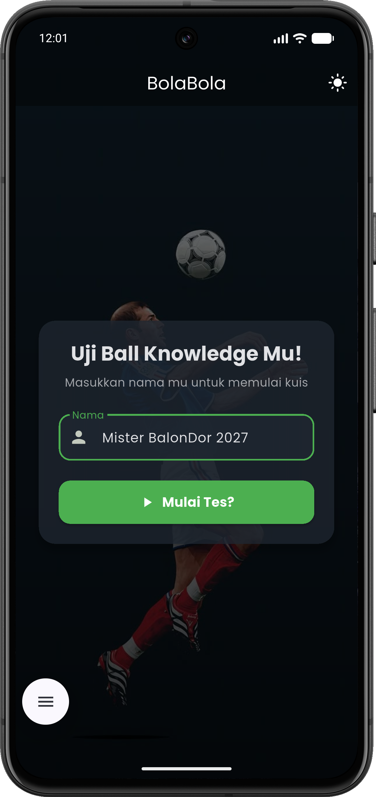
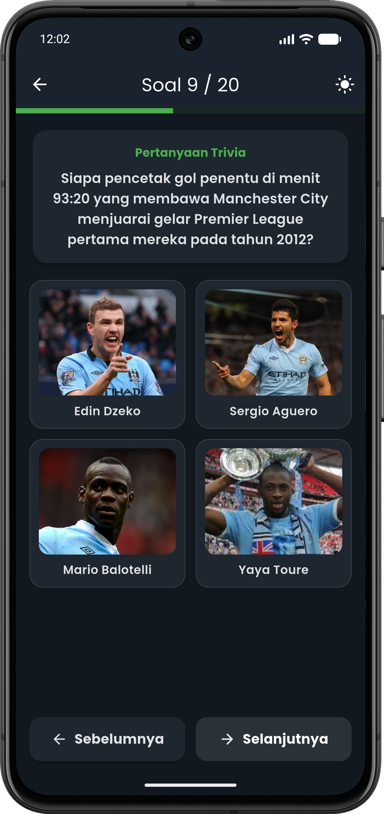
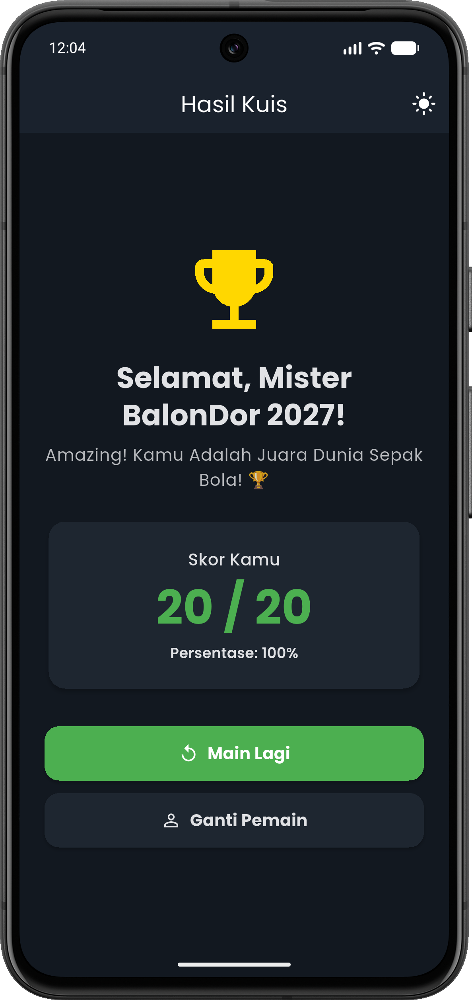

# ⚽ BolaBola

---

* **Nama**: M ZIDAN RURIANO AG
* **NIM**: 241401063
* **Lab**: 5

---

## Informasi Aplikasi

### 1. Nama Aplikasi
**BolaBola**

### 2. Deskripsi Singkat
**BolaBola** adalah aplikasi kuis trivia sepak bola berbasis flutter yang menguji pengetahuan sepak bola pengguna melalui kuis.

### 3. Fitur-Fitur Utama
**Beranda Input Nama**: Pengguna dapat memasukkan nama sebelum memulai kuis dengan sistem validasi form.  
**Kuis Gambar Grid 2x2**: Tampilan 4 pilihan jawaban bergambar pemain sepak bola secara rapi dan proporsional.  
**Feedback Jawaban Seketika**: Indikator warna hijau (benar) dan merah (salah) secara otomatis setelah memilih jawaban.  
**Penjelasan Fakta Sepak Bola**: Box pembahasan fakta sejarah sepak bola muncul otomatis setelah menjawab pertanyaan.  
**Kalkulasi Skor & Evaluasi Dinamis**: Halaman hasil menampilkan skor total, persentase, serta ucapan selamat dinamis berdasarkan pencapaian skor.  
**State Management Anti-Reset (Provider)**: Progres kuis dan jawaban tidak akan hilang atau ter-reset saat layar dirotasi.  
**Dual-Theme (Light & Dark Mode)**: Pengguna dapat beralih antara Light Mode dan Dark Mode secara reaktif melalui AppBar.  
**Desain Responsif & Adaptif**: Menggunakan `ConstrainedBox`, `SingleChildScrollView`, dan `OrientationBuilder` sehingga mendukung layar HP (Portrait/Landscape), Tablet, dan Browser Web.

---

## 📸 Dokumentasi

### 1. Screenshot Tampilan Aplikasi

| Halaman Beranda | Halaman Kuis | Halaman Hasil Skor |
| :---: | :---: | :---: |
|  |  |  |

---

### 2. Link Mockup / Prototype
* 🎨 **Figma Prototype**: https://www.figma.com/design/LUN5WdBKTTq1xwcYJcBA5O/BolaBola?node-id=0-1&t=wTvwMVNms67B9ghU-1

---

### 3. Credit Sumber Aset

#### Custom Font
* **Poppins Font**: [Google Fonts - Poppins](https://fonts.google.com/specimen/Poppins) (OFL License)

#### Lisensi Gambar Pemain & Aset
* **Getty Images**: [gettyimages.com](https://www.gettyimages.com/)
* **Wikimedia Commons**:
  * Harry Kane, Lionel Messi, Cristiano Ronaldo, Rodri, Ousmane Dembele: By Bryan Berlin / WikiPortraits, CC BY-SA 4.0, [Link 1](https://commons.wikimedia.org/w/index.php?curid=195644440), [Link 2](https://commons.wikimedia.org/w/index.php?curid=195518244), [Link 3](https://commons.wikimedia.org/w/index.php?curid=196249374), [Link 4](https://commons.wikimedia.org/w/index.php?curid=195303696), [Link 5](https://commons.wikimedia.org/w/index.php?curid=194950984)
  * Wayne Rooney: By Austin Osuide, CC BY 2.0, [Link Rooney](https://commons.wikimedia.org/w/index.php?curid=1583061)
  * Toni Kroos: By DSanchez17, CC BY 3.0, [Link Kroos](https://commons.wikimedia.org/w/index.php?curid=41865593)
  * Luka Modric: By Дмитрий Голубович, CC BY-SA 3.0, [Link Modric](https://commons.wikimedia.org/w/index.php?curid=62794966)
  * Pemain Lainnya: Bryan Berlin / WikiPortraits, CC BY-SA 4.0, [Link Commons](https://commons.wikimedia.org/)
